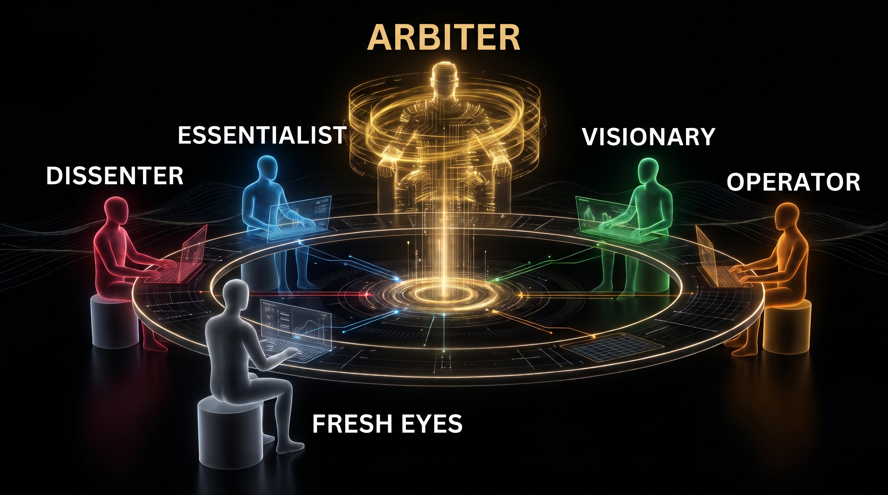

# The Council



A Claude Code skill for hard decisions. Five advisors with opposing lenses answer your question, review each other's answers blind, and an Arbiter turns it all into one verdict.

Inspired by Andrej Karpathy's [LLM Council](https://github.com/karpathy/llm-council).

## How it works

- **Five advisors:** Dissenter, Essentialist, Visionary, Fresh Eyes, Operator.
- **Framing check:** the question is checked for drift and bias before the advisors see it.
- **Blind peer review:** reviewers rank the answers without names; each reviewer's vote for its own advisor doesn't count.
- **Mixed models:** advisors share Opus, Sonnet and Haiku, shuffled every run. The Arbiter runs on Opus.

## Install

```
git clone https://github.com/batikanakdenizz/the-council ~/.claude/skills/the-council
cp ~/.claude/skills/the-council/agents/council-member.md ~/.claude/agents/
```

Needs Python 3 (standard library only).

## Use

```
/the-council <question>        full run, 12 sub-agent calls
/the-council lite <question>   skips peer review, 7 calls
```

Manual only, so no credits are spent on runs nobody asked for.
